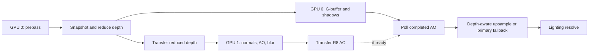

# Screen-space ambient occlusion

SceneBaseSample provides SSAO on the primary GPU and an optional secondary-GPU path. After depth prepass, the secondary path sends depth to GPU 1, reconstructs normals there, computes SSAO and two blur passes, and returns an available completed result before lighting resolve. GPU 0 continues G-buffer/shadow rendering without waiting for the new secondary job. Enable it through the existing sample configuration; it is disabled by default.

For integration of other techniques, see the [MGPU technique guide](mgpu_technique_guide.md). The [fullscreen sample](mgpu_fullscreen_sample.md) demonstrates the simpler case with no scene inputs.

## Algorithm and attribution

The reference is the classic SSAO implementation by **Bogdanov M.K.** in [Multi-GPU-Render-DX12 at commit 9146f83f](https://github.com/Mikhanil/Multi-GPU-Render-DX12/tree/9146f83f4251a2b8acd4e9cc361f9367be597a4c):

- [Ssao.hlsl](https://github.com/Mikhanil/Multi-GPU-Render-DX12/blob/9146f83f4251a2b8acd4e9cc361f9367be597a4c/Shaders/Common/Ssao.hlsl): position reconstruction and 14 occlusion samples.
- [SsaoBlur.hlsl](https://github.com/Mikhanil/Multi-GPU-Render-DX12/blob/9146f83f4251a2b8acd4e9cc361f9367be597a4c/Shaders/Common/SsaoBlur.hlsl): separable, surface-aware Gaussian filtering.
- [SharedSSAO.cpp](https://github.com/Mikhanil/Multi-GPU-Render-DX12/blob/9146f83f4251a2b8acd4e9cc361f9367be597a4c/Common/SharedSSAO.cpp): sample directions, resources and passes.

This implements classic SSAO, not the HBAO or XeGTAO algorithms also present in that repository. Nau uses its own transfer channels, resource pools and render graph.

The shader reconstructs view-space positions from depth. A preceding pass derives a geometric normal from neighboring depth values, choosing the smaller depth discontinuity on each axis, rejecting background/out-of-bounds neighbors and handling isolated pixels. Homogeneous-coordinate increments avoid subtracting two large view positions. It explicitly rounds world-space sphere-map XY to R16G16_FLOAT for the existing AO/blur shader contract. Both devices use the same reconstruction shader; GPU 0 runs it for the primary path and capture references, GPU 1 runs it for offloaded work. This does not reproduce material normal maps or geometry absent from depth prepass.

Fourteen directions cover the eight cube corners and six face directions. A deterministic pixel hash reflects these directions into the normal hemisphere; their lengths span 0.25–1 times the radius. Projected samples estimate occlusion using depth separation, normal alignment, `surfaceEpsilon` and distance fading. Accessibility is `pow(1 - occlusionSum / 14, 6)`.

Bogdanov M.K.'s classic SSAO receives a normal map and depth; his [HBAO path](https://github.com/Mikhanil/Multi-GPU-Render-DX12/blob/9146f83f4251a2b8acd4e9cc361f9367be597a4c/Shaders/Common/HBAO.hlsl) uses depth-derived positions/tangents on the AO device. Nau keeps the classic SSAO sampling algorithm while choosing depth-only transport and local normal reconstruction to start before G-buffer completion.

Two 11-tap Gaussian passes, with sigma 2.5, filter the result horizontally and vertically. Samples across a normal discontinuity (`dot < 0.8`) or the configured view-depth threshold are rejected. AO=1 is neutral. Deferred resolve multiplies ambient diffuse and reflected lighting by screen-space AO in addition to material AO; direct lighting and emission remain independent of this factor.

## Nau conventions and resources

- The camera looks along -Z, projection uses reversed-Z, and shaders use `mul(matrix, vector)`. Position reconstruction uses the G-buffer projection. Background depth=0 produces AO=1.
- AO normals are reconstructed from depth and stored locally as world-space sphere-map XY in `R16G16_FLOAT`; no G-buffer normals or normal texture transfers are required by SceneBaseSample's secondary path.
- Samples outside the image or in front of the near plane are rejected. Reconstruction uses the sampled pixel center to avoid false occlusion on inclined planes.
- Raw AO and horizontal blur use `R32F`; the final filtered map uses `R8_UNORM`. Normals, AO and blur default to half width/height (`resolutionDivisor=2`); use 1 for full resolution on either device. Dimensions use floor division, clamped to one pixel. Reversed-Z depth reduction keeps the nearest depth in each footprint, including odd edges.
- GPU 0 retains a full-size R32F prepass snapshot because G-buffer can subsequently write depth. Late upsampling uses that snapshot and four low-resolution neighbors, rejects other surfaces/background, normalizes surviving bilinear weights and returns AO=1 when no compatible sample exists. The snapshot remains local to GPU 0. Early AO work restores the full viewport before G-buffer.
- The frame graph owns GPU 0 textures. `NauDeviceResourceAllocator` allocates GPU 1 placed resources from Nau heap pools. Root signatures, PSOs, descriptor heaps and a DIRECT queue belong to GPU 1. Shader bytecode comes from the existing asset pipeline.
- When the subsystem is disabled, resolve still binds an existing white texture to its AO SRV. It creates no full-size AO targets or AO passes. Keep this neutral binding valid even when the shader branch disables AO.

The graph order is `z-prepass -> ssao_submit -> fill_gbuffer -> CSM -> ssao_receive -> gbuffer_resolve`. Early submission can overlap secondary work with G-buffer/shadows. The late node polls once before lighting and never waits for unfinished secondary AO.



## Transfer and synchronization

| Data | Direction | Format | Bytes/pixel |
| --- | --- | --- | ---: |
| Raw reversed-Z depth | 0 → 1 | R32_FLOAT (reduced prepass depth) | 4 |
| Filtered AO | 1 → 0 | R8_UNORM | 1 |

At 1920x1080, half-resolution transport is 2,592,000 logical bytes per submitted job (960x540x5), versus 10,368,000 at full resolution. The full-size depth snapshot adds local GPU 0 memory/work; it is not transferred. Row alignment, shared slots and two local copies per transfer add overhead. Depth is copied, not sampled across adapters; position/normal reconstruction runs on the AO device.

`submitSsao` and `tryReceiveSsao` use two channels from `dag_drv3d_multi_gpu.h`, each with three shared slots. The normal path holds one outstanding secondary job; it does not queue more input frames while that job is pending. Constants, output tickets and the source frame number remain associated until reception. `normalBytecode` selects GPU 1 reconstruction; omitting it retains the legacy normal-input channel for existing producers. `depthIsFloat=true` selects R32F input; false preserves the original DEPTH32 contract.

After prepass, submit current reduced depth only if no job is outstanding and the native pass can submit. Before sending, make a GPU-local R32F copy of reduced depth and use that retained texture as the channel input. Two persistent GPU 0 depth textures alternate between pending input and published history; only a successfully received, non-discarded result swaps them. Immediate refill writes the other texture. This adds two local R32F AO-size allocations and one local copy per attempted submission, with no additional cross-adapter payload. The input COPY waits for previous use of native depth; DIRECT waits for input readiness and executes reconstruction/AO/blur. Output overwrite waits for `sourceReleased`. GPU 0 continues G-buffer/shadows.

Immediately before lighting, poll `is_transfer_ready`. If the source COPY is pending, keep history and issue no receive/wait for that ticket. Otherwise copy into the alternate persistent GPU 0 AO texture and publish it together with the retained reduced depth of its source frame. The upsampler compares current full-resolution depth against this paired source depth, never against reduced depth from a different frame. Primary fallback uses current reduced depth. Reception still orders a local GPU 0 copy against earlier destination uses.

Latency is not fixed: same-frame completion is permitted if already ready at the late poll, otherwise an older map is reused. After consuming a job, `ssao_receive` immediately tries to submit current retained depth through the same path as `ssao_submit`; it does not leave the secondary idle until the next frame. The old ticket is cleared first. At most one job is submitted for each source frame, even if an early submission already completed in that frame. If the native slot/channel is still busy, the new attempt is skipped without waiting. Only one secondary job is outstanding; slower GPU 1 skips inputs. Startup without history and actual failure compute locally at the selected AO resolution. This adapts available-result reuse in [HybridSSAOApp by Bogdanov M.K.](https://github.com/Mikhanil/Multi-GPU-Render-DX12/blob/9146f83f4251a2b8acd4e9cc361f9367be597a4c/MGPU-SSAO/HybridSSAOApp.cpp#L215) to Nau's channels/fences. The compatibility `renderSsao` API still schedules an immediate GPU wait; the sample uses the split API.

Constants occupy a 224-byte cbuffer with aligned slots. Slots are reused only after their work completes. Frame submission does not wait for completion on the CPU:

- `submitted`: inputs/work were queued by `submitSsao`, or a ready result was received by `tryReceiveSsao`.
- `busy`: keep pending work and reuse the last received map. Before a valid map exists, compute AO on GPU 0. An early busy check avoids preparing and sending inputs; a later channel refusal can occur after partial submission.
- `failed`: report the secondary failure and use GPU 0.

Resize, mode changes and device changes invalidate the displayed map. Pending results from before a switch are consumed and discarded when secondary execution resumes; they cannot become the new history. AO and its paired depth are invalidated together. Matching source depth rejects displaced surfaces during upsampling, but is not motion reprojection: similar-depth surfaces and camera movement can still expose stale shading. History currently has no maximum age. A configurable age bound with a defined expiry policy is the next step; recomputing on GPU 0 when expired would add primary work during busy periods and change the current reuse policy.

On resize or shutdown, drain channels before releasing the native pass, its resources and allocator. The pass can retain unfinished work for deferred collection. `collectFullscreenResources()` also collects retired SSAO resources and is called by Graphics each frame and before driver teardown. Channel destruction can block on the CPU; an external fence that never signals can prevent shutdown.

## Configuration and controls

Merge these properties into the existing `samples/sceneBase/config/app.json`; preserve other application settings:

```json
"dx12": {"multiGpu": true, "secondaryWarpForTesting": false},
"sample": {
    "ssao": {"enabled": true, "mode": 1, "radius": 0.5, "blur": true, "resolutionDivisor": 2, "useSecondary": true},
    "mgpuDemo": {"enabled": false, "useSecondary": true}
}
```

`mode`: 0 disables the effect, 1 shows the lit scene, 2 shows the AO map. F7 cycles lit → map → off; F8 requests primary/secondary execution. The window title shows mode, actual device path, FPS and ms/frame, averaged over about one second. The render thread posts a coalesced message; the owning window thread applies the title once per timing update. These are wall-clock frame cadence, including CPU/presentation effects, distinct from GPU profiler timings. With SSAO enabled the sample starts its camera at (0, 5, 10), tilted down toward the scene. Move with WASD/QE; rotate by dragging with the left mouse button.

`secondaryWarpForTesting=true` explicitly selects a distinct WARP device, labelled TEST. WARP checks functionality, not hardware performance. A missing or failed secondary device uses GPU 0. Disable the fullscreen demo when viewing AO because it covers the scene.

Defaults are `radius=0.5`, `fadeStart=0.2`, `fadeEnd=1`, `surfaceEpsilon=0.05`, and `blurDepthThreshold=0.2` in scene units. Radius zero produces neutral AO; `blur=false` shows raw AO. These parameters are read at startup.

## Build and functional checks

Configure and build SceneBaseSample with the repository's usual engine build settings. Scripts default to `build/engine/bin/Release/SceneBaseSample.exe`; override `-BuildDirectory` and `-Configuration` for another build. Reconfigure CMake after shader changes: configuration copies shader sources into sample resources.

Run scripts sequentially; each temporarily edits and then restores the same configuration file:

```powershell
./tools/scripts/run_ssao_demo.ps1 -Device primary -Mode lit -Interactive -CaptureFrame 0
./tools/scripts/run_ssao_demo.ps1 -Device warp -Mode lit -CaptureFrame 20 -Seconds 45
python tools/scripts/verify_ssao_capture.py build/ssao-runtime/warp-lit --mode lit --independent-normals
./tools/scripts/run_ssao_demo.ps1 -Device busy -Mode lit -CaptureFrame 20 -Seconds 45
python tools/scripts/verify_ssao_capture.py build/ssao-runtime/busy-lit --mode busy
./tools/scripts/run_ssao_demo.ps1 -Device fallback -Mode lit -Seconds 15
./tools/scripts/run_ssao_demo.ps1 -Device device-switch -Mode lit -CaptureFrame 60 -Seconds 45
```

Other diagnostic modes are `ao`, `off`, `raw`, `zero-radius`, `switch`, `disabled` and device `busy-first`. Secondary validation captures source inputs and a GPU 0 reference when a job is submitted, then reads its outputs and presentation when that job is received when ready. Logs record display and source frame IDs. CaptureFrame is the earliest requested source frame. AO and display dimensions are recorded separately: `filtered.f32` is the low-resolution map, `resolved.f32` is its full-size upsample and `resolve_depth.f32` is the current full-size prepass snapshot. `resolve_low_depth.f32` is the exact reduced depth bound for upsampling; for secondary history it must match `history_depth.f32` and the submitted source depth. A busy capture keeps `depth.f32` as current reduced depth, so it may differ from the retained history depth. The verifier checks this pairing after reception and immediate refill. Busy injection waits for valid history; failure injection waits for a received secondary result. Extra capture work is absent with `-CaptureFrame 0`. Captures must contain loaded geometry; a very early capture can fail while assets are still loading.

Verification checks finite values, [0,1] bounds, neutral background, geometry, and scene/map consistency. The default secondary comparison retains maximum error 0.01 after blur or 0.02 for raw AO. For this depth-only path, explicitly pass `--independent-normals`: maximum error becomes 0.02 after blur or 0.05 raw, with at most 0.01% of pixels exceeding the original strict bound. After subtracting half an R8 quantization step (`0.5/255`, clamped at zero), both modes require residual mean ≤0.00001 and P99.9 ≤0.001. Independently reconstructed normals and discrete sample/blur decisions can cause sparse boundary outliers. The verification JSON records them and the selected comparison mode; this option does not relax finite values, background or presentation checks. Validation captures also save `reference_raw.f32` for diagnosing the unfiltered comparison.

Standalone shader tests execute the production HLSL on D3D11 WARP, including planes, contacts, silhouettes, normal transforms, blur boundaries and an odd image size. Native pass/channel tests use D3D12. Both complement an engine run:

```powershell
cmake -S engine/core/modules/graphics/tests/test_ssao_shader -B build/ssao_tests -A x64
cmake --build build/ssao_tests --config Debug
ctest --test-dir build/ssao_tests -C Debug --output-on-failure
cmake -S engine/core/modules/render/tests/test_multi_gpu -B build/multi_gpu_tests -A x64
cmake --build build/multi_gpu_tests --config Debug
ctest --test-dir build/multi_gpu_tests -C Debug --output-on-failure
```

## Profiling and limitations

Use `-Profile -CaptureFrame 0` for timing runs, or set `NAU_GPU_PROFILER=1` in the process launching the executable. The log's `GPU profiler enabled` line gives the CSV path. See [measurement methodology and WARP example](ambient_occlusion_measurements.md).

The profiler records primary `Frame`, primary AO passes when used, primary `ssao_snapshot_depth`, `ssao_reduce_depth`, `ssao_upsample`, secondary `ssao_reconstruct_normals`, `ssao_raw`, `ssao_blur_h`, `ssao_blur_v`, and COPY halves for `ssao_depth`, `ssao_result`. Each queue has its own timestamp frequency; cross-queue intervals use clock calibration. Unsupported COPY timestamps are omitted with a warning rather than written as zero. The optional transfer observer remains alive until both channel queues drain. Shutdown also reports `submitted` jobs, `resubmitted` jobs queued from the receive node, and maximum displayed history age (`maxAge`). `secondary + primary + reused = frames` counts displayed frames; `submitted` counts jobs sent to GPU 1.

The CSV mode label comes from startup configuration; F7/F8 do not update it. Compare separate runs. Primary `Frame` includes local input/output copies, but pipelined SSAO does not insert a wait for an unfinished secondary AO job. Presentation defaults to vsync; set `video.vsync=false` and `video.adaptive_vsync=false`, or use the runner's `-NoVsync` flag. The engine no longer drains GPU work twice around pre-render jobs by default; [frame scheduling](render_frame_scheduling.md) documents the diagnostic serialization option. GPU timings alone do not prove useful overlap or a speedup. Hardware-pair performance has not been established by the WARP measurements.

Device recovery requires destroying and recreating technique owners around driver recovery. Channel shutdown retains blocking waits. Rare shutdown failures during asynchronous texture loading and `cache/dx12.cache` errors remain unresolved; this implementation does not claim to fix them.

## Check late-node refill

The optional `sample.ssao.traceSubmissions=true` setting logs source-frame submission, reception and resize retirement. It is off by default and should stay off for performance measurements. The runner enables it with `-TraceSubmissions`:

```powershell
./tools/scripts/run_ssao_demo.ps1 -Device warp -Mode lit -NoVsync -CaptureFrame 500 -TraceSubmissions -Seconds 30 -Label refill
python tools/scripts/verify_ssao_capture.py build/ssao-runtime/warp-lit-refill --mode lit --independent-normals
python tools/scripts/verify_ssao_submission_trace.py build/ssao-runtime/warp-lit-refill.stdout.log --require-refill
```

The trace check pairs every result with its submitted source, rejects a second outstanding job or duplicate submission of a source frame, and verifies that each late refill immediately follows reception in the same frame. It reconciles the trace with `submitted`/`resubmitted` counters. Same-frame receptions are permitted but do not cause another submission of that source frame. Resize retires the pending job; mode/device switches discard obsolete results before refilling from current inputs.

## Source map

| Component | Source |
| --- | --- |
| Shader inputs, reconstruction, samples and blur | `samples/sceneBase/content/shaders/include/ssao_common.hlsli`, `src/ssao.hlsl`, `src/ssao_blur.hlsl` |
| Frame graph, materials, controls and history | `engine/core/modules/graphics/src/render_window/ambient_occlusion.*`, `ambient_occlusion_nodes.cpp` |
| Public producer API and constants | `engine/core/modules/render/include/nau/3d/multi_gpu_ssao*.h` |
| Native pass, transport bridge and retirement | `engine/core/modules/render/src/drv3d_DX12/device_ssao_pass.*`, `multi_gpu_ssao.cpp` |
| DIRECT/COPY profiler adapters | `engine/core/modules/graphics/src/render_window/ambient_occlusion*profiler*` |
