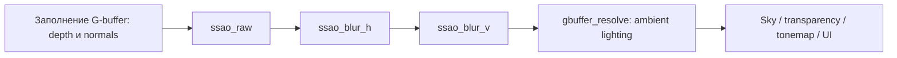
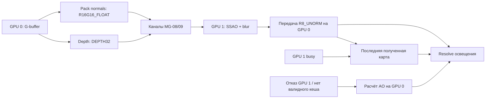

# AO в ветке mgpu/AO: GPU 0 и MGPU

Ветка `mgpu/AO` начинается от объединённой ветки команды MG-12 (`b81cfd1e`), содержащей MG-06–MG-13. Реализованы SSAO на GPU 0 и путь depth/normals → GPU 1 → SSAO + blur → GPU 0. Первый путь служит эталоном и fallback при отказе. При занятом GPU 1 используется последняя полученная AO-карта; после resize и переключения режима/устройства история сбрасывается.

Работа использует инфраструктуру MGPU команды. В Render расширяются контракт MG-08/09, ресурсная обёртка MG-10 и отдельный проход AO. Общие файлы Graphics содержат точки подключения к G-buffer, render graph и resolve освещения. ShaderProgramDatabase и основной аллокатор Nau не переписываются.

## Первоисточник

Источник — [Multi-GPU-Render-DX12, commit 9146f83f](https://github.com/Mikhanil/Multi-GPU-Render-DX12/tree/9146f83f4251a2b8acd4e9cc361f9367be597a4c). В `MGPU-SSAO` находятся **три** алгоритма: SSAO, HBAO и XeGTAO. Сейчас `IsUseXeGTAO` по умолчанию равен `true`. Этот этап переносит классический SSAO, а не XeGTAO.

Основные исходники:

- [Shaders/Common/Ssao.hlsl](https://github.com/Mikhanil/Multi-GPU-Render-DX12/blob/9146f83f4251a2b8acd4e9cc361f9367be597a4c/Shaders/Common/Ssao.hlsl): восстановление точки по глубине, 14 соседних выборок, оценка закрытой части полусферы.
- [Shaders/Common/SsaoBlur.hlsl](https://github.com/Mikhanil/Multi-GPU-Render-DX12/blob/9146f83f4251a2b8acd4e9cc361f9367be597a4c/Shaders/Common/SsaoBlur.hlsl): Gaussian blur с отказом от смешивания разных поверхностей.
- [Common/SharedSSAO.cpp](https://github.com/Mikhanil/Multi-GPU-Render-DX12/blob/9146f83f4251a2b8acd4e9cc361f9367be597a4c/Common/SharedSSAO.cpp): ресурсы устройств, 14 направлений, PSO и проходы размытия.
- [MGPU-SSAO/HybridSSAOApp.cpp](https://github.com/Mikhanil/Multi-GPU-Render-DX12/blob/9146f83f4251a2b8acd4e9cc361f9367be597a4c/MGPU-SSAO/HybridSSAOApp.cpp): выбор алгоритма, параметры, normal/depth pass и копирование между устройствами.

В варианте двух GPU приложение Богданова М.К. передаёт нормали и глубину на второе устройство, считает там AO и возвращает ambient map. Код этого транспорта не копировался в Nau: используются каналы команды MG-08/09. Владение памятью и синхронизация согласованы с MG-10 и backend Nau.

## Как работает перенесённый алгоритм

1. Из depth восстанавливается положение текущего пикселя в пространстве камеры. Из G-buffer извлекается нормаль и переводится туда же.
2. Используются 14 направлений: восемь углов куба и шесть направлений его граней. Направления отражаются относительно случайного вектора и переворачиваются в полусферу нормали. Длины лежат в диапазоне 0,25–1 радиуса.
3. Каждая соседняя точка проецируется обратно в экран. Из глубины находится видимая поверхность в этой области. Чем сильнее она выступает перед текущей точкой и чем лучше направлена к её нормали, тем больше вклад в затемнение.
4. `surfaceEpsilon` убирает ложное самозатенение, а `fadeStart/fadeEnd` ограничивают влияние удалённых объектов. Итоговая доступность окружающего света — `pow(1 - occlusionSum / 14, 6)`.
5. Два прохода фильтра, горизонтальный и вертикальный, используют по 11 отсчётов Gaussian с sigma 2,5. Сосед учитывается только при `dot(normals) >= 0.8` и разнице глубины в пространстве камеры не более 0,2.
6. Полученная величина умножает окружающее диффузное освещение и отражение в deferred resolve, дополнительно к AO материала. Прямое освещение и emission не умножаются на экранный AO.

AO=1 означает доступный окружающий свет; AO=0 — максимальное затемнение. Это экранное приближение: невидимые и находящиеся за экраном объекты не участвуют.

## Адаптация к Nau

- Nau использует правую систему координат камеры с направлением взгляда по **-Z**, `mul(matrix, vector)` и **reversed-Z**. Применяется `getProjMatrixReverseZ()`, та же проекция, что у G-buffer. Формула из исходника с положительной глубиной не копируется.
- Нормали Nau хранятся в world space, сжаты sphere-map encoding в двух компонентах `GBUF_NORMAL_ROUGH_MET`. Шейдер распаковывает их и умножает на view matrix.
- Фон с depth=0 сразу получает AO=1. Выборки за экраном и перед ближней плоскостью отбрасываются. Положение соседа восстанавливается в центре прочитанного пикселя, чтобы не создавать ложное AO на наклонной плоскости.
- Вместо отдельной случайной текстуры применяется фиксированный целочисленный hash координат. Результат воспроизводим и не меняется от кадра к кадру из-за нового random seed.
- Исходная AO-карта и горизонтальный blur используют `R32F`, финальная карта — `R8_UNORM`. Перед AO отдельный проход выделяет две компоненты sphere-map normals в `R16G16_FLOAT`. Оба устройства получают одинаковые упакованные нормали. Half-resolution upsampling и изменение качества по нагрузке пока не применяются.
- Текстуры GPU 0 создаёт frame graph. Ресурсы GPU 1 создаёт `NauDeviceResourceAllocator` из MG-10 через существующий пул Nau; отдельная DIRECT-очередь исполняет три прохода AO. Production-код AO не создаёт собственные committed-ресурсы.

## Проходы и файлы



- `samples/sceneBase/content/shaders/include/ssao_common.hlsli` — контракт констант/текстур, восстановление позиции, нормали, стабильный random.
- `samples/sceneBase/content/shaders/src/ssao.hlsl` — 14 выборок.
- `samples/sceneBase/content/shaders/src/ssao_blur.hlsl` — фильтр и просмотр карты.
- `engine/core/modules/graphics/src/render_window/ambient_occlusion.*` — загрузка материалов, параметры, команды отрисовки, F7, необязательные captures.
- `ambient_occlusion_nodes.cpp` — один узел с тремя AO-текстурами. Он выполняет три прохода на выбранном GPU; текстуры GPU 0 следуют разрешению окна и управляются frame graph.
- `gbuffer_nodes.cpp` / `deferred_resolve.hlsl` — подключение результата к освещению. Для остальных примеров и выключенного режима используется нейтральный коэффициент.

При полностью отключённой подсистеме новый SRV в resolve всё равно получает существующую белую текстуру. Полноразмерные AO-текстуры и три AO-прохода при этом не создаются. Оставлять этот вход пустым нельзя: на локальном NVIDIA-драйвере это приводило к падению даже при выключенной ветке шейдера.

Материалы и shader cache работают через существующий asset pipeline. GPU 1 получает байткод тех же рабочих VS/PS и тот же набор констант.

## Как подключён MGPU



1. GPU 0 заполняет настоящий G-buffer. Отдельный проход упаковывает только две компоненты нормали в `R16G16_FLOAT`; roughness и metalness не передаются. Каналы MG-08 отправляют упакованные normals и depth (`DEPTH32`) на GPU 1 без чтения на CPU.
2. Очереди копирования GPU 1 ждут fence последнего использования входных текстур. Для этого в `receive_on_secondary` добавлен необязательный `destination_free`, передаваемый существующему `CrossAdapterChannel::receive`. Старые вызовы совместимы на уровне исходного кода; бинарная сигнатура изменена, поэтому модули требуется пересобрать. Это изменение общего контракта нужно учитывать владельцам MG-04/08.
3. `DeviceSsaoPass` на GPU 1 ждёт оба входа, исполняет SSAO и оба направления blur на одной DIRECT-очереди. Normals, depth, две промежуточные R32F карты, итоговая R8-карта и upload buffer выделены через пул Nau.
4. Матрицы и параметры текущего кадра копируются в 224-байтовый cbuffer. Два набора из трёх 256-байтовых слотов не перезаписываются до завершения своих команд. Занятый слот возвращает `busy` без CPU-ожидания.
5. Канал результата передаёт финальную R8-карту на GPU 0. Очередь GPU 0 ждёт её перед resolve; GPU 1 ждёт `sourceReleased` перед следующей перезаписью результата. При успешной передаче depth, normals и матрицы принадлежат одному кадру. На GPU 0 сохраняется копия последней полученной карты.
6. При `busy` используется сохранённая карта: новый AO не считается на GPU 0, а при заранее обнаруженном занятом слоте входы даже не упаковываются и не отправляются. Поздний `busy` от канала может возникнуть после частичной передачи или расчёта GPU 1; предварительного резервирования всех трёх каналов общий API не предоставляет. Это согласованный запасной путь, допускающий запаздывание затенения относительно движущейся камеры/геометрии; reprojection и ограничение возраста истории пока отсутствуют. После resize или переключения режима/устройства история сбрасывается. Пока валидной истории нет, а также при выключенном MGPU или настоящем отказе, AO считается на GPU 0. Ошибки второго устройства передаются в MG-11.

Depth GPU 1 — SRV `R32_FLOAT`, принимающий сырые 32-битные строки из typeless `DEPTH32`; channel строит footprint каждого endpoint отдельно. Два descriptor heap содержат RTV/SRV, а память самих ресурсов выделяет пул Nau.

Фактический контракт передачи:

| Данные | Формат | Байт на пиксель |
| --- | --- | ---: |
| Нормали GPU 0 → GPU 1 | R16G16_FLOAT, sphere-map XY | 4 |
| Глубина GPU 0 → GPU 1 | исходная reversed-Z DEPTH32, линеаризация в SSAO | 4 |
| AO GPU 1 → GPU 0 | R8_UNORM | 1 |

Для 1920×1080 полезная нагрузка — 18 662 400 байт (18,66 МБ), вместо прежних 49 766 400 байт: в 2,67 раза меньше. Это сумма логических данных трёх передач, без выравнивания строк, дублирования копий транспортом и служебных объектов. Глубина пока отличается от предложенной линейной R32_FLOAT семантикой, но не размером. Общая таблица задач этим изменением не редактировалась.

Только в режиме capture дополнительный канал R32F возвращает исходную AO-карту для проверки. В обычном рендеринге этого канала и readback нет. Файлы `*-filtered.f32` содержат нормализованные значения R8, преобразованные в float32 при сохранении; это формат диагностического файла, а не передаваемой текстуры.

- `nau/3d/multi_gpu_ssao.h`, `multi_gpu_ssao_types.h` — API и контракт констант без привязки Graphics к нативным объектам.
- `drv3d_DX12/device_ssao_pass.*` — очередь, PSO, SRV/RTV, три прохода, слоты констант и отложенное освобождение.
- `drv3d_DX12/multi_gpu_ssao.cpp` — три канала MG-08/09 и порядок их вызовов.
- `drv3d_DX12/device_resource.*` — расширение обёртки MG-10 для текстур нужного формата.
- `tests/test_multi_gpu/test_device_ssao_pass.cpp` — рабочие HLSL на D3D12 WARP, проверка `busy` и жизненного цикла памяти.

Resize дренирует каналы, затем освобождает старый проход и создаёт ресурсы нового размера. Деструктор нативного прохода не ждёт бесконечно: незавершённое состояние удерживается в retired-списке вместе с аллокатором и fences. Сборщик вызывается через используемый командой `collectFullscreenResources()` каждый кадр и при shutdown. Разрушение каналов сохраняет контракт MG-08/09 с CPU-ожиданием завершения копирования.

## Запустить и посмотреть

По умолчанию эффект отключён. В `samples/sceneBase/config/app.json`:

```json
"sample": {
    "ssao": {"enabled": true, "mode": 1, "radius": 0.5, "blur": true, "useSecondary": true},
    "mgpuDemo": {"enabled": false, "useSecondary": true}
}
```

`mode`: 0 — эффект выключен; 1 — сцена с AO; 2 — серая AO-карта. **F7** переключает `1 → 2 → 0 → 1`, **F8** — запрос GPU 0/GPU 1. Заголовок окна и лог показывают фактический путь. Режим MG-12 следует выключить, иначе его fullscreen демонстрация закроет сцену. Для двух GPU нужен `dx12.multiGpu=true`; `dx12.secondaryWarpForTesting=true` подставляет WARP и отмечает TEST в заголовке. При отсутствии второго устройства работает GPU 0.

При `ssao.enabled=true` камера начинает над сценой в `(0, 5, 10)` и смотрит немного вниз. Стандартная камера SceneBaseSample находится в начале координат внутри модели шлема, поэтому её исходный кадр почти чёрный. Перемещение — WASD/QE, поворот — мышью с зажатой левой кнопкой.

Параметры в единицах сцены: `radius=0.5`, `fadeStart=0.2`, `fadeEnd=1`, `surfaceEpsilon=0.05`, `blurDepthThreshold=0.2`. `radius=0` даёт нейтральную карту. `blur=false` позволяет увидеть исходную карту. Параметры читаются при запуске; F7 меняет режим во время работы.

Автоматическая проверка временно меняет настройки и восстанавливает исходный файл:

Для самостоятельного просмотра без автоматического закрытия: `./tools/scripts/run_ssao_demo.ps1 -Mode lit -Interactive`. Закрыть окно обычным крестиком. После закрытия исходная конфигурация восстановится.

```powershell
./tools/scripts/run_ssao_demo.ps1 -Mode lit
./tools/scripts/run_ssao_demo.ps1 -Mode ao
./tools/scripts/run_ssao_demo.ps1 -Mode off
./tools/scripts/run_ssao_demo.ps1 -Mode raw
./tools/scripts/run_ssao_demo.ps1 -Mode zero-radius
./tools/scripts/run_ssao_demo.ps1 -Mode switch
./tools/scripts/run_ssao_demo.ps1 -Mode disabled
python tools/scripts/verify_ssao_capture.py build/ssao-runtime/lit --mode lit
```

Сценарии запускаются **последовательно**. `Seconds`, `BuildDirectory`, `Configuration` и `CaptureFrame` можно переопределить. Файлы `.f32` — сырые little-endian float32; размеры указаны в логе и PPM. По умолчанию captures снимаются на кадре 150. На ранних кадрах сцена ещё может загружаться: проверка отклоняет снимок без геометрии. В обычном режиме `captureAtFrame=0`: readback и запись файлов не выполняются.

```powershell
# Полный путь с WARP и эталоном GPU 0 на том же кадре:
./tools/scripts/run_ssao_demo.ps1 -Device warp -Mode lit -CaptureFrame 20 -Seconds 45
python tools/scripts/verify_ssao_capture.py build/ssao-runtime/warp-lit --mode lit
./tools/scripts/run_ssao_demo.ps1 -Device device-switch -Mode lit -CaptureFrame 60 -Seconds 45
./tools/scripts/run_ssao_demo.ps1 -Device fallback -Mode lit -Seconds 15
# Аппаратный GPU 1 или самостоятельный просмотр с WARP:
./tools/scripts/run_ssao_demo.ps1 -Device secondary -Mode lit -Seconds 30
./tools/scripts/run_ssao_demo.ps1 -Device warp -Mode lit -Interactive
# Busy: на capture-кадре принудительно занять путь GPU 1 и проверить повторное использование карты:
./tools/scripts/run_ssao_demo.ps1 -Device busy -Mode lit -CaptureFrame 20 -Seconds 45
python tools/scripts/verify_ssao_capture.py build/ssao-runtime/busy-lit --mode busy
# Первый busy, когда ещё нет предыдущей карты: один кадр должен посчитать GPU 0:
./tools/scripts/run_ssao_demo.ps1 -Device busy-first -Mode lit -CaptureFrame 20 -Seconds 45
```

Валидационный режим дополнительно считает эталон GPU 0 только на кадре capture, сохраняет `*-reference.f32` до преобразования результата в R8, затем получает настоящий результат GPU 1. Проверяется максимум ошибки ≤0,01 после blur (≤0,02 в `raw`). Из каждой абсолютной ошибки вычитается только неизбежная половина шага R8 (`0,5/255`, с отсечением снизу в ноль); для остатка сохраняются пороги средней ≤0,00001 и 99,9-го процентиля ≤0,001. Это отделяет квантование восьмибитной карты от расхождения вычислений. Direct3D допускает разные порядки fused-операций и погрешности отдельных инструкций: [правила floating point Microsoft](https://learn.microsoft.com/en-us/windows/win32/direct3d11/floating-point-rules). Контролируется распределение ошибок, а не только среднее.

До перехода на компактные форматы максимальное различие в проверенном `raw` — один пиксель `(530, 563)`, GPU 0: 1, GPU 1: 0,9861274. CPU-разбор того же кадра воспроизводит результат WARP: выборка №1 проецируется в `(555,6955; 566,0)`, ровно на границу строк. Соседние строки 565/566 дают `distanceZ` около 0,03964/0,05928 при `surfaceEpsilon=0,05`: меняется один вклад в сумму. Это согласуется с выбором соседнего texel из-за округления; прямой трассировки инструкций GPU 0 не выполнялось. После blur максимальное различие в этом месте — около 0,000373.

## Проверка шейдеров

```powershell
# На машине с VS 2022:
$vsGenerator = "Visual Studio 17 2022"
# На локальной машине с VS 2026 используйте "Visual Studio 18 2026".
cmake -S engine/core/modules/graphics/tests/test_ssao_shader -B build/ssao_tests -G $vsGenerator -A x64
cmake --build build/ssao_tests --config Debug
ctest --test-dir build/ssao_tests -C Debug --output-on-failure
```

Тесты исполняют именно рабочие HLSL на WARP с debug layer: фон, плоскость и наклонная плоскость, контакт с препятствием, нулевой радиус, выключение, удалённое препятствие, силуэт, поворот world normals в camera space, границы глубины/нормалей и оба направления фильтра. Нечётное разрешение 79×53 дополнительно проверяет края изображения. Для компактного тестового стенда используется D3D11; подключение к D3D12 Nau проверяется отдельным запуском SceneBaseSample. Это разные уровни проверки.

После изменения файлов `content/shaders` нужно повторить конфигурацию CMake перед сборкой: SceneBaseSample копирует исходники в `resources/shaders` именно при конфигурации. Иначе ресурсный shader cache может остаться со старым набором entry points.

## Первый этап: проверка GPU 0, 23.10.2026

Собран `SceneBaseSample`, конфигурация Release. Шейдерные тесты WARP: **11 из 11 прошли** с D3D11 debug layer. Реальная сцена проверена через D3D12 на NVIDIA GeForce RTX 4060 Ti, разрешение captures — 634×611.

| Режим | Результат окончательного прогона | Кадров AO |
| --- | --- | ---: |
| `lit` | Сцена с AO, blur изменяет карту, фон остаётся белым | 705 |
| `off` | Сцена без эффекта, AO-карта нейтральная | 1887 |
| `ao` | Представление на экране совпадает с итоговой AO-картой | 1332 |
| `raw` | Blur выключен; исходная и итоговая карты совпадают | 1264 |
| `zero-radius` | Нейтральная карта | 1257 |
| `switch` | Во время работы пройдены все три режима | 1286 |
| `disabled` | Подсистема AO не запускается, приложение штатно закрывается | 0 |

Все перечисленные окончательные запуски завершились с кодом 0 без принудительного завершения. Счётчики кадров не являются измерением производительности: продолжительность запусков различалась, а кадр 150 включает синхронный readback.

Проверка captures дополнительно контролирует NaN/Inf, диапазон [0,1], отсутствие затенения фона, наличие геометрии и освещённого изображения. Для debug-режимов сравнивается сам экранный результат с AO-картой. В `lit` около 10,8 тыс. пикселей получили AO ниже 0,95; blur изменил около 223 тыс. пикселей.

Артефакты находятся локально в `build/ssao-runtime`: `lit-scene.png`, `lit-filtered.png`, `*-verification.json`, `*.result.json` и `*.stdout.log`. Сборка записана в `build/ao-build-neutral.log`, WARP-тесты — в `build/ao-shader-tests.log`.

Оставшиеся наблюдения:

- В одном промежуточном запуске `off` графика и AO завершились, но общий async runtime не отпустил процесс: появился лог `application completion is blocked`. Через 15 секунд сценарий завершил процесс принудительно. Повтор `off` прошёл штатно; причина единичного зависания не установлена. Сохранён `build/ssao-runtime/off-intermittent-shutdown.log`. Это не следует считать проверенным исправлением shutdown.
- В логах остаётся ошибка сохранения `cache/dx12.cache` из-за отсутствующего каталога; она уже отмечалась в работе MG-06/MG-12. В этом этапе код pipeline cache не менялся.
- Ручная доставка сообщений F7/F8 отдельно не проверялась. Автопереключение проверяет переходы режимов и устройств.

## Второй этап: проверка MGPU, 23.10.2026

Этот раздел фиксирует первоначальную реализацию с RGBA32F normals, R32F результатом и пересчётом на GPU 0 при busy. Текущие форматы и политика описаны выше; новые проверки приводятся отдельно ниже. Старые числа ошибок не являются результатом проверки R16G16/R8.

Собран `SceneBaseSample` Release и `test_multi_gpu` с настоящим Render/NauDeviceResourceAllocator. Общий набор: **82 passed, 3 skipped из 85**, ошибок нет. Пропущены два теста второй физической карты и один тест принудительного удаления устройства (`RemoveDevice`). Пять новых тестов `DeviceSsao.*` прошли с D3D12 debug layer: фон/плоскость, контакт и blur, занятые слоты констант, удержание памяти при незавершённом fence и отложенное освобождение после деструктора. Отдельная Debug-сборка без Render тоже прошла эти пять тестов.

| Сценарий | Всего кадров | GPU 1 | GPU 0 | Проверенный результат |
| --- | ---: | ---: | ---: | --- |
| `warp-lit` | 67 | 67 | 0 | Оба направления передачи, три прохода AO, сравнение с GPU 0 |
| `device-switch-lit` | 99 | 50 | 49 | Переключение устройств и resize |
| `fallback-lit` | 1540 | 2 | 1538 | Искусственный отказ на кадре 3, продолжение на GPU 0 |
| `warp-raw` | 51 | 51 | 0 | Blur выключен, карта показана на экране, сравнение с GPU 0 |

Все эти процессы завершились с кодом 0 без принудительного закрытия. Счётчики не являются замерами FPS; WARP используется как функциональный второй адаптер.

Сравнение на одном кадре:

- `warp-lit`, 634×611: max error 0,000373, mean error 0,000000211.
- `device-switch-lit`, 1073×692: max error 0,007027, mean error 0,000000591; лишь 13 из 742516 пикселей отличаются более чем на 0,005.
- `warp-raw`, 634×611: max error 0,013873, mean error 0,000000548; один пиксель отличается более чем на 0,01. Разбор этой выборки приведён выше.

В логе переключения подтверждено изменение размера с 634×611 на 1073×692 и пересоздание прохода GPU 1. После resize на новом размере проверены и геометрия, и сравнение AO с эталоном. Фон сохраняет AO=1, NaN/Inf отсутствуют, в `raw` исходная и итоговая карты совпадают.

Основные логи: `build/ao-mgpu-final-build.log`, `build/ao-mgpu-all-tests.log`, `build/ao-mgpu-standalone-tests.log`. Captures и JSON-проверки: `build/ssao-runtime/warp-lit-*`, `device-switch-lit-*`, `fallback-lit-*`, `warp-raw-*`.

## Профайлер MG-13

AO подключает GPU 1 через существующий `D3D12TimestampSource` MG-13, с частотой и калибровкой своей DIRECT-очереди. В CSV записываются `ssao_raw`, `ssao_blur_h`, `ssao_blur_v` с `gpu=1`; на GPU 0 — те же проходы при локальном расчёте, `ssao_pack_normals`, `ssao_reuse` и общий `Frame`. Render получает необязательный observer, Graphics реализует подключение к MG-13. Observer удерживается вместе с незавершённым проходом, чтобы его query heap/readback не освобождались под работающим GPU.

```powershell
# Функциональная проверка профайлера с WARP, без capture/readback и дополнительного эталона GPU 0:
./tools/scripts/run_ssao_demo.ps1 -Device warp -Mode lit -Profile -CaptureFrame 0 -Seconds 45
# На ноутбуке для сравнения реальных GPU:
./tools/scripts/run_ssao_demo.ps1 -Device primary -Mode lit -Profile -CaptureFrame 0 -Seconds 30
./tools/scripts/run_ssao_demo.ps1 -Device secondary -Mode lit -Profile -CaptureFrame 0 -Seconds 30
```

CSV сохраняются в `build/ssao-runtime/*-profile-timings.csv`. Сценарий проверяет timestamp-замеры трёх проходов GPU 1 и обеих половин передач, если COPY-таймеры поддерживаются. Self-test MG-13 выключен, чтобы не занимать его слот устройства посторонними копиями. Сохраняются `busy` и новый `reused`; сумма `secondary + primary + reused` равна `frames`. Успешных новых карт GPU 1 может быть меньше числа показанных кадров.

Передачи `ssao_normals`, `ssao_depth` и `ssao_result` измеряются на собственных COPY-очередях каналов MG-08. Для каждого имени CSV содержит:

| Суффикс | Что измерено |
| --- | --- |
| `/src` | Копирование из локального ресурса в shared-слот на GPU-отправителе |
| `/dst` | Копирование из shared-слота в локальный ресурс на GPU-получателе |
| `/sum` | Сумма длительностей `/src` и `/dst`, без ожидания между ними |
| `/span` | Интервал от начала `/src` до конца `/dst`, после переноса обеих шкал в QPC через калибровку соответствующих COPY-очередей |

`/src` и `/dst` используют частоту своей очереди; сырые timestamps разных устройств друг из друга не вычитаются. `/span` записывается только при доступной калибровке обеих очередей, включает промежуточное ожидание и планирование, но не ожидания до начала `/src`. `Frame` на GPU 0 по-прежнему включает ожидание результата AO. Наличие перекрытия полезной работы и выигрыш FPS нельзя доказать одними длительностями проходов: для этого нужны сопоставимые аппаратные прогоны/трасса очередей. WARP используется для проверки работоспособности измерения.

Используется существующий `D3D12TimestampSource`, расширенный для COPY: проверка `D3D12_FEATURE_D3D12_OPTIONS3::CopyQueueTimestampQueriesSupported`, heap `D3D12_QUERY_HEAP_TYPE_COPY_QUEUE_TIMESTAMP`. Если таймеры не поддерживаются или не созданы, соответствующая половина пропускается с предупреждением в логе; нулевое время вместо отсутствующего замера не записывается. Это требование [D3D12 для COPY timestamp heaps](https://learn.microsoft.com/en-us/windows/win32/api/d3d12/ne-d3d12-d3d12_query_heap_type).

Render передаёт observer native COPY-листы, Graphics собирает готовые timestamp-пары без ожидания CPU и добавляет их в тот же CSV MG-13. Пары связываются по имени канала и кадру отправки. Число ожидающих замеров ограничено; при исчерпании пула пропускается измерение, сама передача продолжается. Observer и его query/readback остаются у канала до завершения обеих COPY-очередей. Необязательное поле `TransferChannelDesc::profiler` меняет ABI общего MG-04/08-контракта: исходные вызовы остаются совместимыми, но модули нужно пересобрать вместе. Владельцам MG-04/08/13 следует учитывать это при интеграции; сообщения им автоматически не отправлялись.

```powershell
# Прогоны выполняются последовательно, без captures и GPU 0 reference:
./tools/scripts/run_ssao_demo.ps1 -Device primary -Mode lit -Profile -CaptureFrame 0 -Seconds 45 -Label copy
./tools/scripts/run_ssao_demo.ps1 -Device warp -Mode lit -Profile -CaptureFrame 0 -Seconds 45 -Label copy
python tools/scripts/summarize_ssao_timings.py `
    build/ssao-runtime/lit-profile-copy-timings.csv `
    build/ssao-runtime/warp-lit-profile-copy-timings.csv `
    --warmup-frames 10 --output build/ssao-runtime/mg13-copy-measurements
```

Скрипт сводки проверяет конечность и знак длительностей, уникальность строк и равенство `/sum = /src + /dst` с учётом округления CSV; сохраняет Markdown и JSON с числом измерений, средним, медианой и P95. Первые 10 кадров исключаются только из статистики, а целостность пар проверяется по всему файлу. Это не управляемый нагрузочный benchmark: сцена загружается асинхронно, аппаратная пара здесь заменена WARP.

В `dx12.cpp::get_presentation_mode_from_settings` проверка настройки vsync закомментирована и сейчас всегда возвращается `PresentationMode::VSYNCED`. Режим показа в этой работе не менялся. Сравнивать FPS как доказательство ускорения нельзя: при достижении частоты монитора результат ограничен vsync. Для анализа используются GPU-времена из CSV, а не обратная величина среднего FPS. Timestamp-длительность не становится фиксированной частотой монитора, хотя нагрузка и планирование GPU могут зависеть от режима показа.

Фактические результаты после добавления COPY-замеров: [замеры SSAO и передач MG-13](ambient_occlusion_measurements.md). В двух 45-секундных запусках GPU 0 и GPU 0 + WARP процессы завершились штатно; проверены все 207 пар копирования. Render-тесты: 84 passed, 3 skipped из 87; самостоятельный Debug: 80 passed, 3 skipped из 83. Это дополняет историческую серию ниже.

## Проверка после отзыва: R16G16/R8, busy и MG-13

`SceneBaseSample` Release собран повторно. Общий набор Render: **83 passed, 3 skipped из 86**; пропущены те же проверки возможностей устройства. Добавлен тест форматов и предела округления R8; тест retirement дополнительно проверяет удержание observer профайлера до завершения GPU. После исправления тестового аллокатора тест retirement повторён в Render-сборке, а все **6 DeviceSsao-тестов** прошли в самостоятельной Debug-сборке. Шейдерные тесты: **11/11**.

Новые функциональные запуски: RTX 4060 Ti + WARP, captures 634×611. Все перечисленные ниже процессы завершились с кодом 0 без принудительного завершения; это счётчики, а не замеры FPS.

| Сценарий | Frames | Secondary | Primary | Reused | Что проверено |
| --- | ---: | ---: | ---: | ---: | --- |
| `warp-lit` | 69 | 69 | 0 | 0 | Компактная передача, blur и эталон R32F того же кадра |
| `busy-lit` | 72 | 71 | 0 | 1 | На кадре 20 точно повторена карта кадра 19 |
| `busy-first-lit` | 72 | 71 | 1 | 0 | При busy на первом кадре история ещё отсутствует |
| `warp-raw` | 57 | 57 | 0 | 0 | Blur выключен; разница raw/filtered не превышает округление R8 |
| `fallback-lit` | 2099 | 2 | 2097 | 0 | Отказ на кадре 3, переход на актуальный расчёт GPU 0 |
| `device-switch-lit` | 135 | 68 | 67 | 0 | F8 и сброс истории при смене устройства |
| `off` | 1276 | 0 | 1276 | 0 | Нейтральная карта AO=1 и штатный выход |
| `warp-lit-profile` | 70 | 70 | 0 | 0 | CSV с ненулевыми замерами всех трёх проходов GPU 1 |

Максимальная ошибка относительно R32F-эталона: `warp-lit` — 0,002002, переключение — 0,006472, `raw` — 0,011765. Средняя ошибка сверх половины шага R8 во всех этих сравнениях меньше 0,000000203; 99,9-й процентиль остатка равен нулю. Проверка blur учитывает округление R8, чтобы простое преобразование формата не считалось сработавшим фильтром.

В busy-сценарии проверяются точное совпадение с сохранённой картой, более ранний номер её кадра и отсутствие пересчёта GPU 0. У старой карты могут быть затенённые пиксели там, где текущий depth уже показывает фон: это ожидаемое ограничение согласованного пути без reprojection. Проверка фона по текущей глубине применяется к свежим картам, а не к истории. Повторный resize в этой серии не вызывался; сброс при изменении размера реализован в `prepareSecondary`, первоначальный путь resize проверен во втором этапе.

При одном коротком 15-секундном запуске с профайлером процесс завершился с `0xc0000005` уже после `Graphics shutdown completed`. По дампу и linker map место падения — продолжение `TextureAssetView::createFromAssetAccessor` при обращении к ресурсу текстуры после остановки графики. Это указывает на гонку завершения с асинхронной загрузкой; её исправление не подтверждено. Повторный 45-секундный запуск с GPU 1 и 8-секундный с GPU 0 завершились штатно. Это ограничение сохраняется вместе с ранее отмеченным единичным зависанием `off`; оно не объявляется исправленным добавлением MG-13.

Логи: `build/ao-feedback-build.log`, `ao-feedback-reference-build.log`, `ao-feedback-mgpu-tests.log`, `ao-feedback-standalone-tests.log`, `ao-feedback-shader-tests.log`, `ao-feedback-lifetime-recheck.log`; запуски — `build/ao-feedback-*-run*.log`. Captures, JSON и CSV — `build/ssao-runtime`. Дополнительный `-Label <имя>` сохраняет повторные запуски под разными именами.

## Ограничения производительности

Текущий успешный путь выполняет GPU 0 G-buffer → GPU 1 AO → GPU 0 resolve в одном кадре; busy использует последнюю карту. Ускорение пока не заявляется. Для передачи используются полноразмерные normals R16G16_FLOAT и AO R8_UNORM; WARP проверяет функциональность. Полезное перекрытие очередей, half-resolution и измерение выигрыша на аппаратной паре остаются следующими работами.

Перед сдачей MG-14 изменения стоит разбить на зависимые PR: общий контракт/ресурсы, GPU 1 и шейдеры, подключение Graphics/сэмпла, тесты/скрипты/документация. История опубликованной ветки и ветки других участников сейчас не переписываются.
