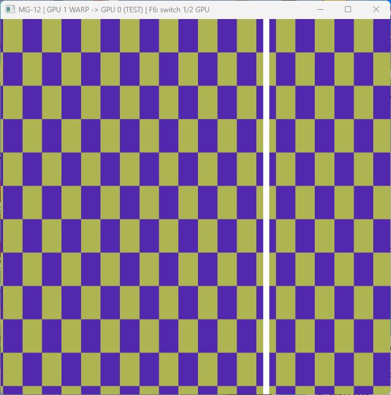
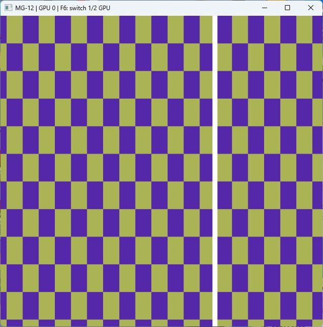

# MG-12: экранный пример SceneBaseSample

Продолжение интеграции от 22 октября: проход MG-10 и передача MG-08/09 подключены к настоящему render graph. История исходных задач и авторство Андрея Гаркуши сохранены в общей интеграционной ветке `mgpu/MG-12-integration-test`.

## Что делает пример

`mgpu_demo_present` исполняется после сцены, outline и отладочного UI, чтобы демонстрация занимала всё окно. Он выводит анимированную клетчатую текстуру с движущейся белой полосой. Размер передаваемой текстуры фиксирован: 960×540. При изменении размера окна меняется масштаб вывода, ресурсы канала не пересоздаются каждый кадр.

В режиме двух устройств `MultiGpuDemo` передаёт готовый bytecode из штатного shader cache в публичный мост `d3d::mgpu::FullscreenProducer`. Мост владеет проходом MG-10 и каналом MG-08/09 внутри Render; Graphics не обращается к приватным DX12-заголовкам. Память прохода выделяет `NauDeviceResourceAllocator`, использующий существующие пулы Nau и placed resources. Shared heap остаётся обязанностью канала межадаптерной передачи.

Кадр проходит следующую цепочку:

1. Меняется параметр анимации в constant buffer прохода.
2. GPU 1 выполняет fullscreen triangle в своей текстуре и сигнализирует fence готовности.
3. `send_from_secondary` ставит копирование в shared slot после готовности текстуры.
4. `sourceReleased` регистрируется в проходе через `waitForExternalWork`: следующий draw не перезапишет источник до окончания копии.
5. `receive_on_primary` передаёт данные в обычную отслеживаемую `BaseTexture` GPU 0. Обёртка согласует состояния и ожидания с command stream движка.
6. `stretch_rect` показывает полученную текстуру в backbuffer.

В режиме одного GPU тот же шейдер, из того же cache и с теми же параметрами, выполняется материалом движка сразу в текстуру GPU 0. Клавиша **F6** переключает запрошенный режим. Заголовок окна показывает фактический путь; WARP явно помечается как `TEST`. Сам факт существования второго устройства не считается выполнением работы на нём.

Это демонстрационный fullscreen-проход, а не AO и не распределение всей сцены между GPU. Обычные узлы сцены пока продолжают выполняться за демонстрацией. Из этого примера нельзя делать вывод об ускорении.

## Запуск

В `samples/sceneBase/config/app.json`:

```json
"dx12": {
    "multiGpu": true,
    "secondaryWarpForTesting": true
},
"sample": {
    "mgpuDemo": {
        "enabled": true,
        "useSecondary": true
    }
}
```

Показан вариант для одного аппаратного адаптера и WARP. Для двух аппаратных GPU установить `secondaryWarpForTesting=false`. Для проверки отсутствия второго устройства также оставить `false`. WARP не подставляется автоматически: обычный выбор адаптера по-прежнему отвергает software device. Даже в тестовом режиме запрещено выбирать тот же LUID, что у GPU 0. При `multiGpu=false` второй адаптер не создаётся.

Настройки в Git оставлены выключенными, поэтому обычный запуск sample сохраняется. Не заменять весь раздел `sample` из примера выше: существующие `assetsToReload` и остальные настройки нужны приложению.

Повторяемые сценарии с временной правкой и восстановлением конфигурации:

```powershell
./tools/scripts/run_mg12_demo.ps1 -Mode warp
./tools/scripts/run_mg12_demo.ps1 -Mode primary
./tools/scripts/run_mg12_demo.ps1 -Mode disabled
./tools/scripts/run_mg12_demo.ps1 -Mode no-secondary
./tools/scripts/run_mg12_demo.ps1 -Mode switch
./tools/scripts/run_mg12_demo.ps1 -Mode failure
python tools/scripts/verify_mg12_capture.py build/mg12-runtime/warp.ppm
```

По умолчанию скрипт использует `build/engine/bin/Release/SceneBaseSample.exe`, работает 45 секунд и отправляет обычный запрос закрытия окна. Есть параметры `BuildDirectory`, `Configuration`, `Seconds`. Результаты и логи сохраняются в `build/mg12-runtime`. Не запускать сценарии одновременно: они временно используют один конфигурационный файл. Скрипт проверяет наличие свежего capture, итоговую статистику и фактическое выполнение нужного пути; одного кода выхода 0 недостаточно.

Сценарий `switch` переключает режим каждые 90 кадров; это проверяет ту же ветку управления, что F6. `failure` на 120-м кадре вызывает MG-11 с искусственным HRESULT ошибки передачи. Это проверка реакции приложения на сигнал ошибки, а не физического удаления адаптера. `no-secondary` проверяет отсутствие адаптера только на машине с одним аппаратным GPU; на машине с двумя он корректно выберет второй.

Дополнительные параметры `sample.mgpuDemo` предназначены для проверки: `autoSwitchFrames`, `failAtFrame`, `captureAtFrame`, `capturePath`. По умолчанию они выключены. Единственный readback выполняется в заданном кадре и сохраняет фактическую текстуру GPU 0 в PPM вместе с фазой анимации. Скрипт `verify_mg12_capture.py` проверяет все 518400 пикселей по формуле шейдера. В обычном render loop CPU readback отсутствует.

## Откат и время жизни

Если второе устройство недоступно, сразу используется GPU 0. Ошибка инициализации/выполнения проходит через `report_secondary_gpu_failure`. Заполненный канал сам по себе не считается отказом: при `busy` сохраняется последний полученный кадр, а до первого успешного приёма рисуется GPU 0. Отсутствие успешной передачи в течение пяти секунд приводит к откату. После ошибки MG-11 сохраняет состояние отказа до восстановления драйвера/перезапуска.

Переключение на GPU 0 не уничтожает канал на лету. При завершении владелец сначала дожидается engine/channel work, затем сбрасывает проход и освобождает текстуру. `collectFullscreenResources` вызывается каждый кадр из `GraphicsImpl`, включая режим одного GPU, и перед выключением драйвера. Бесконечного опроса количества retired resources нет.

F6 обрабатывает отдельный `MultiGpuDemoInput`, зарегистрированный через штатный `IWindowMessageHandler`. Поток окна накапливает отпускания F6 в атомарном счётчике, поток рендера забирает их на следующем кадре. Это сохраняет короткое нажатие даже между двумя медленными WARP-кадрами. Обработчик привязан только к окну активной демонстрации и отсоединяется при её уничтожении.

## Подтверждение экранного результата

Снимки сделаны из настоящего окна финальной сборки. На первом показан путь WARP → GPU 0, на втором — GPU 0 после F6. Цвет меняется со временем, поэтому на снимках разные фазы одной анимации.





Ручная проверка F6 → F6 подтвердила возврат к передаче. За 60 секунд выполнено 4275 кадров: 225 переданных со второго устройства и 4050 на GPU 0. Закрытие штатное, exit code 0. Переходы зафиксированы на кадрах 118 и 4168; сам capture в этом ручном прогоне выполнен на GPU 0. Отдельный автоматический `warp` сохраняет и проверяет именно переданный кадр.

Полная сборка Render, Graphics, SceneBaseSample и тестов прошла в Release x64. CTest с пулом Nau: **77 passed, 3 skipped, 0 failed** из 80, 57,43 с. Standalone Debug: **73 passed, 3 skipped, 0 failed** из 76, 41,69 с. Два новых теста проверяют явное создание настоящего WARP и запрет повторного выбора primary adapter. Пропуски относятся к двум физическим GPU и удалению аппаратного сигнализирующего устройства.

Проверка на RTX 4060 Ti + WARP, Windows x64, VS 18 / MSVC 19.51, SDK 10.0.26100:

| Сценарий | Кадры | Передано с WARP | Отрисовано GPU 0 | Пиксели capture |
|---|---:|---:|---:|---|
| `warp`, 35 секунд | 172 | 172 | 0 | 518400/518400 совпали |
| `primary`, 15 секунд | 2451 | 0 | 2451 | 518400/518400 совпали |
| `disabled`, 15 секунд | 2455 | 0 | 2455 | 518400/518400 совпали |
| `no-secondary`, 15 секунд | 2491 | 0 | 2491 | 518400/518400 совпали |
| `switch`, 45 секунд | 408 | 228 | 180 | 518400/518400 совпали |
| `failure`, 35 секунд | 2176 | 119 | 2057 | 518400/518400 совпали |

Все шесть процессов штатно закрылись, exit code 0, без принудительного завершения. В автоматическом переключении подтверждены переходы на кадрах 90, 180, 270, 360; capture кадра 240 получен со второго устройства. В отказе на кадре 120 MG-11 сообщил `secondary transfer failed or unsupported`, приложение продолжило рисовать на GPU 0; capture на кадре 180 проверяет картинку после отката. Отдельный `warp` сохранил именно переданный кадр 120. Суммарно проверено **3110400 пикселей**, несовпадений **0**.

Обычная сцена с выключенной демонстрацией также запущена на 12 секунд: MG-12 не активировался, закрытие штатное, exit code 0. Флаги в конфигурации после всех сценариев восстановлены. Новые C++-файлы прошли `clang-format --dry-run --Werror`, изменения — `git diff --check`.

Логи: `build/test-engine-mg12.log`, `build/test-standalone-mg12.log`, `build/mg12-engine-results.xml`, `build/mg12-standalone-results.xml`, `build/mg12-runtime/*.result.json`, `build/mg12-runtime/*.stdout.log`, `build/mg12-runtime/pixel-verification.jsonl`. Сырые captures и логи остаются локально; в Git включены только отчёт и два снимка окна.

## Дополнительная проверка на GTX 1650 + Intel UHD 630

По переданному отчёту сокомандника пример проверен на ноутбуке с двумя аппаратными адаптерами: GPU 0 — NVIDIA GTX 1650 (`RowMajor=0`), GPU 1 — Intel UHD 630 (`RowMajor=1`). Между NVIDIA и Intel канал MG-08/09 переносит данные через общие буферы и копирование; cross-adapter texture на NVIDIA не требуется.

- В общем CTest-прогоне успешно выполнены **75 из 76** тестов. Единственный `Not Run` — `MultiGpuFallbackStatus`: исполняемый файл `test_multi_gpu_status.exe` не был собран при сборке только `--target test_multi_gpu`. Результат повторного запуска после сборки второго target пока не сообщён.
- Отдельная группа тестов на двух GPU: **32 из 32 passed**, включая `MultiGpuIntegration.AnimatedFullscreenPassArrivesOnOtherAdapter`, передачу, fence и проход MG-10.
- На переданных снимках окна подтверждены режимы `MG-12 | GPU 1 -> GPU 0 | F6: switch 1/2 GPU` и `MG-12 | GPU 0` после F6. Пометок WARP/TEST нет. В обоих режимах видны клетчатая анимация и белая полоса; разные цвета и положение полосы соответствуют разным фазам анимации.

Для запуска пропущенного теста нужно собрать оба исполняемых файла:

```powershell
cmake --build build/multi_gpu_tests --config Debug --parallel 4
ctest --test-dir build/multi_gpu_tests -C Debug -R MultiGpuFallbackStatus --output-on-failure
```

## Известные ограничения вне приёмки MG-12

- Ожидания MG-08 при освобождении канала остаются блокирующими. Если внешняя зависимость никогда не сигнализируется, канал может задержать завершение. Исправление требует безопасного удержания всех зависимых ресурсов; простой тайм-аут с их освобождением не годится.
- MG-13 пока не измеряет фактические DIRECT/COPY очереди этого примера. Его self-test и поле `mode` в CSV не доказывают выполнение конкретного прохода на втором устройстве.
- Ошибка сохранения `cache/dx12.cache` воспроизводилась до подключения этого примера и разбирается отдельно.
- Потеря физического GPU и бесконечно зависшая внешняя очередь не моделируются искусственным `failAtFrame`.
- Device recovery с живым каналом требует предварительного освобождения и повторного создания владельца; пример рассчитан на запуск, переключение, fallback и штатный выход.

WARP используется для локальной функциональной проверки двух отдельных D3D12-устройств и межадаптерной передачи. Дополнительно сокомандник подтвердил работу на аппаратной паре GTX 1650 + UHD 630, как описано выше. Замеры производительности WARP не являются замерами ускорения. В локальных Release-запусках sample debug layer выключен; отдельные CTest включают его и проверяют диагностические сообщения.
