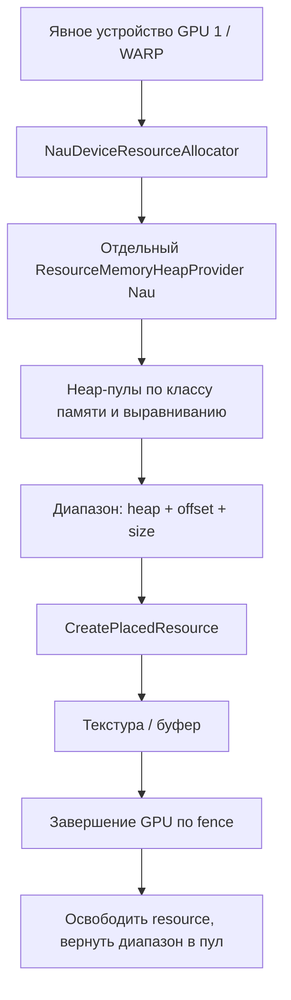
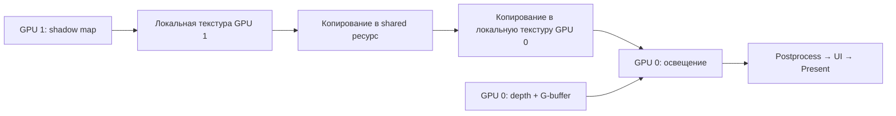

# MGPU и MG-10: состояние, память и проход второго устройства

Обновление 21.10: [исправлено бесконечное ожидание в деструкторе](mgpu_shutdown_2026_10_21.md).
Проход удерживает аллокатор через shared-владение; незавершённые объекты освобождаются отложенно.

Дата среза: 20.10.2026. Репозиторий: `absolutez3ro/NauEnginePublic`.
База этой работы — `f26dcd9c`, полученный из ветки `mgpu/MG-10-device-resources-review`.
Полноэкранный проход уже добавлен Андреем Гаркушей в этом коммите; текущая доработка переводит его память на менеджер Nau и уточняет синхронизацию.

## Что говорить преподавателю

«Мы выделили отдельный путь создания ресурсов и выполнения простого прохода на втором D3D12-устройстве.
Он получает своё устройство явно, создаёт текстуру, буфер констант, root signature и PSO, исполняет
вершинный и пиксельный шейдеры и записывает результат в собственную текстуру.
Проверка читает пиксели обратно и сравнивает шахматный рисунок — это проверка выполнения шейдера.

После замечания по памяти мы убрали `CreateCommittedResource` из рабочего компонента.
Теперь используется отдельный экземпляр штатного `ResourceMemoryHeapProvider` Nau:
он выделяет диапазоны из heap, а ресурсы создаются через `CreatePlacedResource`.
Память возвращается в пул только после завершения работы GPU.

В нашей приёмке второе устройство — WARP, программный D3D12-адаптер.
Тест с аппаратным GPU и WARP проверяет отдельное владение объектами и полноэкранную отрисовку.
Это достаточно для согласованной функциональной проверки MG-10. Измерять ускорение таким тестом нельзя.
Передача результата в основной кадр, интеграция с render graph и перенос настоящей техники, например AO,
остаются отдельным этапом».

## Что есть в MGPU

Наличие файла или открытого PR не означает, что компонент уже соединён с остальными.
Проверка ниже — чтение текущей ветки и удалённых веток; чужие ветки в рабочую не сливались.

| Часть | Где находится | Реальное состояние |
|---|---|---|
| MG-06: второе устройство | `multi_gpu_device.h`, `dx12.cpp`; [PR 1](https://github.com/absolutez3ro/NauEnginePublic/pull/1) | В текущей ветке есть выбор отличного LUID, создание устройства, запрос возможностей, `get_device(GpuId)`, обработка отсутствия второго GPU. Автовыбор исключает WARP; тесты выбирают WARP явно. |
| MG-07: очереди и команды | В плане — отдельная задача поверх MG-06 | MG-10 содержит собственную минимальную DIRECT-очередь, command allocators/list и локальный fence. Это не доказывает готовность общего набора DIRECT/COMPUTE/COPY и общего планировщика MG-07. При объединении надо согласовать владельца очередей. |
| MG-04: договор передачи | [PR 2](https://github.com/absolutez3ro/NauEnginePublic/pull/2), `dag_drv3d_multi_gpu.h` | Описаны texture/buffer payload, направления, tickets, точки готовности и освобождения источника. Одних деклараций недостаточно для копирования. |
| MG-09: межадаптерный fence | [PR 3](https://github.com/absolutez3ro/NauEnginePublic/pull/3) | Реализация в отдельной ветке. Не подключена к проходу MG-10 в текущей сборке. |
| MG-08: канал передачи | [PR 5](https://github.com/absolutez3ro/NauEnginePublic/pull/5), база MG-09 | Есть реализация shared-ресурсов, очередей копирования и переходов между ресурсами Nau на GPU 0 и native-ресурсами GPU 1. Требуется интеграция и проверка вместе с MG-10. |
| MG-10: память, PSO, простой проход | [PR 6](https://github.com/absolutez3ro/NauEnginePublic/pull/6), текущая работа | Отдельный проход существует и проверяется тестами. Доработаны размещение ресурсов в пуле Nau, завершение работы и ожидание внешнего потребителя. |
| MG-11: откат | [PR 4](https://github.com/absolutez3ro/NauEnginePublic/pull/4) | Есть состояния причин отката и проверки здоровья устройства. Это не автоматический перенос уже отправленных команд на GPU 0. В текущей ветке отсутствует объединённая обработка отказов техники/канала. |
| MG-13: измерения | `mgpu/MG-13-nau-energy-mg13`, `ba48907e` | Изменения GPU-profiler, timestamps и режимов. Здесь не собирались и не проверялись; ускорение всей системы не установлено. |
| MG-12: сквозной пример | В плане — отдельная задача | GPU 1 должен рисовать, MG-08/09 передавать, GPU 0 показывать. В текущей ветке MG-10 такой связки нет; тестовый readback не заменяет показ результата на основном GPU. |
| Порт отдельного MGPU-рендера | `sm_team/mgpu_features_transfer`, `c5342e81` | Большой модуль `Mgpu`, классы PEPEngine и отдельный ShadowMap sample. Это иной путь интеграции; не доказано, что он уже заменяет проходы штатного Nau render graph. |

### Сверка с полной таблицей

Источник: [план MGPU](https://docs.google.com/spreadsheets/d/1NzrqsS1q573dORmqTrznOkFpkMBi3giS7bSwbgrtMWA/edit),
прочитан 20.10.2026: лист «Задачи», A1:L16, и лист «что передаём», A1:B4.
Это план и заявления участников; подтверждённый результат определяется кодом и выполненными проверками.
Например, колонка «К проверке 10.10» называет MG-01 и MG-04 закрытыми, а «Статус» — «Взята» и «В работе».

| Задачи | Что требуется по таблице | Состояние в таблице, колонка J |
|---|---|---|
| MG-01 / MG-02 | Общий форк и воспроизводимая сборка | Взята / Готово |
| MG-03 / MG-05 | Замеры передачи и требования команд к данным | Готово / Готово |
| MG-04 | Общий контракт ресурсов, передачи, fence и отката | В работе |
| MG-06 / MG-07 | Второе устройство и его очереди | На ревью / В работе |
| MG-08 / MG-09 | Общий ресурс и синхронизация между устройствами | В работе / На ревью |
| MG-10 / MG-11 | Ресурсы и шейдерный проход; откат на один GPU | В работе / На ревью |
| MG-12 / MG-13 | Сквозной показ результата; тайминги 1/2 GPU | Свободна / Взята |
| MG-14 / MG-15 | Стиль, PR и документация для команд | Свободна / Свободна |

MG-10 находится в строке 11: дедлайн **21.10.2026**, зависимость **MG-06**, минимум — текстура, буфер и PSO,
критерий — собственная текстура с результатом полноэкранного шейдера на GPU 1.
MG-12 со сроком 24.10 — следующий сквозной этап. Таблица перечисляет для него MG-07/08/09;
по смыслу ему также нужен производитель изображения, который может дать MG-10.
Сроки MG-14/15 — 31.10; наличие нашего отчёта ещё не закрывает общекомандную приёмку этих задач.
В доступной книге только два листа: отдельного листа «Замеры» нет, поэтому отметка «Готово» у MG-03
сама по себе не даёт чисел для расчёта выигрыша. Чужие статусы в таблице не изменялись.

### Ваша техника — AO, а рисунок с тенями — другой пример

Лист «что передаём», строка 4, относится к команде Гаркуша / Езерский / Климчук:
GPU 0 → GPU 1 передаются линейная глубина R32_FLOAT и encoded-normal R16G16_FLOAT,
обратно — AO map R8_UNORM перед освещением. Разрешение 1920×1080, каждый кадр;
цель — 0 кадров задержки, запасной вариант — переиспользование предыдущей AO map.
MG-10 даёт основу для такого прохода, но сам алгоритм AO и его входные текстуры пока не реализует.

В плане есть два места, требующих уточнения при интеграции:

1. Нормали названы выходом того же depth prepass. В текущем `gbuffer_nodes.cpp` z-prepass связывает
   depth и UID target, вызывает `renderDepth()`. G-buffer с нормалями заполняется позже, в `fill_gbuffer`.
   Для текущего рендера AO с готовыми нормалями следует запускать после `fill_gbuffer`;
   более ранний запуск потребует отдельного изменения prepass.
2. `GBUF_NORMAL_ROUGH_MET` по `deferredRenderer.h` имеет A32B32G32R32F: 16 байт/пиксель.
   R16G16_FLOAT — 4 байта/пиксель. Передача упакованных нормалей вместо целого target уменьшает
   именно этот payload в **4 раза**, а не в 2. Уменьшение 8 → 4 байт относится к сравнению двух FP32-каналов
   с двумя FP16-каналами. Линеаризация depth и преобразование формата/упаковки требуют GPU-прохода,
   обычный `CopyTextureRegion` сам такую математику не выполняет.

Для указанных форматов полезные данные за кадр: depth 8 294 400 байт + normals 8 294 400 + AO 2 073 600
= **18 662 400 байт (17,80 МиБ)** суммарно в обе стороны. Это расчёт размера, без row padding, служебных расходов,
дополнительных локальных копий и времени проходов; это не измеренная скорость и не доказательство ускорения.
При 0 кадров задержки обе передачи входят в зависимость текущего освещения; нужен замер MG-13.

Сообщения о проверках 02.10 в чужих документах — исторические результаты их авторов, не результаты текущего запуска на этом компьютере.

## Что было неудачно в выделении памяти

Фрагмент на скриншоте заполняет **описание свойств heap**. Сам по себе он ещё ничего не выделяет:

```cpp
heap.Type = heap_type;
heap.CreationNodeMask = 1;
heap.VisibleNodeMask = 1;
```

Node mask выбирает узел внутри переданного устройства. Значение `1` означает его узел 0.
Это корректно для отдельного одноузлового устройства GPU 1; замена на `2` не выбирает вторую видеокарту.
Видеокарта выбирается через адаптер и созданный на нём `ID3D12Device`.
[Документация свойств heap](https://learn.microsoft.com/en-us/windows/win32/api/d3d12/ns-d3d12-d3d12_heap_properties).

Далее прежний `DeviceResource` вызывал `CreateCommittedResource`. Такой ресурс получает собственное неявное выделение памяти.
Это законный D3D12 API, удобный для прототипа, но он обходил пул Nau и его правила размещения ресурсов.
Точную формулировку преподавателя восстановить нельзя; архитектурная причина замечания здесь обоснованнее, чем объявление node mask ошибкой.
[CreateCommittedResource](https://learn.microsoft.com/en-us/windows/win32/api/d3d12/nf-d3d12-id3d12device-createcommittedresource).

Новая цепочка:



Менеджер использует размер и выравнивание из `GetResourceAllocationInfo`, свойства устройства и классы памяти.
Он может разместить несколько ресурсов в одном heap и использовать освободившиеся диапазоны.
Пустой heap может быть освобождён штатной политикой Nau; это не обещание бессрочного хранения всех heap.
Ошибки отдельного пула возвращаются его владельцу, не записываются в `api_state.lastErrorCode`.
Для UMA, включая WARP, отдельный пул использует бюджет LOCAL-сегмента для CPU-visible памяти:
нулевой NON_LOCAL-бюджет иначе сводил размер heap к размеру каждого запроса. Политика основного пула не меняется.

`CreateHeap` не исчезает: его вызывает менеджер, когда в подходящем пуле нет места.
Простая замена «один committed resource» на «один вручную созданный heap и один placed resource» не дала бы преимущества pooling.

RTV descriptor heap — другая сущность. Он хранит дескриптор представления текстуры, а не пиксели.
У прохода остаётся один собственный RTV heap с одним дескриптором, создаваемый при инициализации.
Перед каждым полноэкранным draw выполняется `DiscardResource` для корректной инициализации placed render target:
все его пиксели затем записывает шейдер.
[Правила placed resources](https://learn.microsoft.com/en-us/windows/win32/api/d3d12/nf-d3d12-id3d12device-createplacedresource).

## Проход по коду MG-10

Все пути ниже относительно корня репозитория; производственные файлы находятся в
`engine/core/modules/render/src/drv3d_DX12/`, тесты — в `engine/core/modules/render/tests/test_multi_gpu/`.

1. **`multi_gpu_device.h` и `dx12.cpp`** — обнаружение и владение вторым устройством.
   `ApiState` содержит основной `Device`, `SecondaryGpuDevice` и единственную `ShaderProgramDatabase`.
   В `texture.cpp` по-прежнему 46 строк с вызовами `get_device()`. Общая система материалов ещё не стала независимой от устройства.

2. **`device_resource_allocator.h`** — контракт выделения памяти. Запрос содержит описание ресурса, тип памяти,
   начальное состояние и optional clear value. Успех возвращает native resource и ненулевой token.
   Token нужен для возврата правильного диапазона, это не D3D12 handle.

3. **`nau_device_resource_allocator.h/.cpp`** — реализация контракта через Nau.
   `init()` находит DXGI-адаптер по LUID переданного устройства и настраивает собственный пул.
   `allocate()` получает allocation info, выбирает memory class, резервирует диапазон и создаёт placed resource.
   При ошибке создания диапазон возвращается. `shutdown()` отказывается завершаться при живых ресурсах.
   Аллокатор обязан жить дольше ресурсов и прохода; вызовы выполняются последовательно в потоке рендера.

4. **`resource_manager/heap_components.h/.cpp`** — существующий нижний слой Nau.
   Сохраняются его алгоритмы размещения и объединения свободных диапазонов.
   Добавлена возможность локальной обработки ошибок отдельного устройства; основной путь использует прежний режим по умолчанию.

5. **`device_resource.h/.cpp`** — RAII-владелец ресурса и его allocation token.
   `createRenderTarget()` описывает RGBA8-текстуру с `ALLOW_RENDER_TARGET`.
   `createBuffer()` поддерживает DEFAULT, UPLOAD и READBACK, выбирает соответственно COMMON, GENERIC_READ и COPY_DEST.
   Здесь больше нет собственной политики создания heap. `reset()` освобождает ресурс, затем возвращает диапазон аллокатору.
   Сам этот класс не знает, когда закончился GPU: синхронизация — обязанность владельца.

6. **`device_fullscreen_pass.h/.cpp`: `init()`** — получает аллокатор, размеры и готовые shader bytecode.
   На его устройстве создаются DIRECT queue, два command allocator, command list, fence/event, RTV,
   root signature и graphics PSO. Создаются target, constant buffer и readback buffer.
   Существующая база материалов и PSO GPU 0 не переиспользуется для чужого устройства.

7. **Встроенный HLSL** — VS строит один треугольник по `SV_VertexID`, без vertex buffer.
   Он покрывает весь target. PS использует координаты пикселя: нечётные клетки получают цвет из `b0`,
   чётные — обратный RGB с alpha 1. Это проверяемая текстура, а не просто вызов очистки.
   В тестах DXBC компилируется `D3DCompile`; рабочий компонент получает готовый bytecode.

8. **`execute()`** — ждёт прежнюю работу выбранного command allocator перед повторным использованием,
   пишет цвет в его 256-байтный слот constant buffer, записывает команды и отправляет очередь.
   Последовательность: COMMON → RENDER_TARGET → discard → bind PSO/root/RTV → `DrawInstanced(3, 1, 0, 0)`.
   При запросе readback далее идут COPY_SOURCE, `CopyTextureRegion` и возврат target в COMMON.
   Без readback target сразу возвращается в COMMON. После отправки очередь сигналит fence.

9. **`readPixels()`** — читает только завершённый readback. Учитывает `RowPitch`, возвращает плотный RGBA8-массив.
   Для отрисовки и передачи между GPU readback не нужен; он нужен автоматической проверке.

10. **`waitForExternalWork()`** — добавляет GPU-ожидание fence потребителя.
    Одной точки `source_ready` недостаточно: перед перезаписью target нужно дождаться `sourceReleased` канала передачи.
    Fence должен быть создан/открыт на устройстве прохода. Чужой необработанный fence отклоняется.
    Сам канал MG-08 этим методом не создаётся.

11. **`reset()` и деструктор** — обеспечивают завершение работы перед возвратом памяти.
    Тайм-аут не равен потере устройства: явный `reset(timeout)` возвращает ошибку и оставляет ресурсы.
    После исправления 21.10 деструктор проверяет завершение без ожидания и передаёт незавершённый State
    на отложенное освобождение. State удерживает аллокатор и внешние fence; `collectRetiredResources()`
    освобождает его после завершения либо подтверждённого удаления устройства. Выход не блокируется.
    Ошибка `Signal` после `ExecuteCommandLists` также не отменяет отправленные команды: они остаются учтёнными,
    а повторная отправка запрещена до восстановления точки завершения.

## Что именно проверяется

Два режима сборки используют одни и те же проверки отрисовки и владения:

- standalone — небольшой **тестовый** аллокатор с committed resources, без линковки всего Nau;
- engine — `Render` и настоящий `NauDeviceResourceAllocator`; дополнительно проверяется размещение двух буферов
  в одном пуле heap, возврат диапазонов и запрет shutdown при живых ресурсах.

Тестовый committed-аллокатор находится только в `tests/test_multi_gpu/test_resource_allocator.h`.
Он не является запасным путём рабочего рендера.
Для подтверждения исправления памяти нужен именно engine-вариант.

Проверки включают buffer upload → DEFAULT → readback, очистку target, shader checkerboard,
размер 37×19 с выравниванием строк, смену констант, повторное использование слотов,
отказ на неправильном shader bytecode, debug ERROR/CORRUPTION и оставшиеся resource/heap.
Отдельный тест удерживает очередь внешним fence, вызывает `reset(0)` и проверяет,
что ресурсы остаются живыми; затем снимает ожидание и проверяет результат.
`MultiGpuWarpPair.FullscreenPassOnWarpIsIndependentOfPrimaryHardware` проверяет проход 1920×1080
на WARP при одновременно существующем аппаратном устройстве.

Тесты двух физических адаптеров оставлены как дополнительные. Их пропуск на этом компьютере
не блокирует согласованную приёмку через WARP.
Эти тесты не проверяют cross-adapter передачу, ускорение, устойчивость всей сцены при потере устройства
или включение нового прохода в основной кадр.

Команды для машины с настроенными зависимостями:

```powershell
cmake -S engine/core/modules/render/tests/test_multi_gpu -B build/multi_gpu_tests
cmake --build build/multi_gpu_tests --config Debug
ctest --test-dir build/multi_gpu_tests -C Debug --output-on-failure

# В существующем полном build дерева Nau, со всеми его dependency options:
cmake -S . -B build/mg10_engine_check -DBUILD_SHARED_LIBS=OFF -DNAU_MGPU_ENGINE_TESTS=ON
cmake --build build/mg10_engine_check --config Release --target test_multi_gpu --parallel 2
ctest --test-dir build/mg10_engine_check -C Release -R 'MultiGpu|DeviceResource|DeviceFullscreenPass' --output-on-failure
```

Engine-тест требует статической сборки: проверяемый heap provider — внутренний компонент `Render`.
Тестовое приложение инициализирует логирование Nau до создания менеджера памяти.

### Результаты на этом компьютере, 20.10.2026

- Windows, Visual Studio 18 / MSVC 19.51, NVIDIA GeForce RTX 4060 Ti и Microsoft WARP.
- `Render`, `test_multi_gpu` и `SceneBaseSample` собраны в Release, `BUILD_SHARED_LIBS=OFF`.
  Путь программы: `build/mg10_engine_check/bin/Release/SceneBaseSample.exe`.
- Проверки с настоящим пулом Nau: **48 пройдено, 2 пропущено, 0 ошибок** из 50 зарегистрированных;
  итоговый CTest занял 11,22 с. Лог: `build/mg10_engine_check/test-acceptance-oct20.log`.
- Пропущены только `MultiGpuHardware.CreatesSecondPhysicalDeviceWhenAvailable` и
  `MultiGpuHardware.DebugLayerShutdown`: в системе нет второй физической видеокарты.
  Проверка hardware + WARP выполнена успешно и является согласованной приёмкой MG-10.
- Standalone Debug: **44 пройдено, 2 пропущено, 0 ошибок** из 46;
  лог: `build/multi_gpu_tests/test-acceptance-oct20.log`.
- Проверены общий heap для нескольких буферов, создание после освобождения диапазона,
  возврат памяти после ошибки `CreatePlacedResource`, отказ shutdown при живых ресурсах
  и сохранение памяти при тайм-ауте внешнего fence.

Лог сборки: `build/mg10_engine_check/build-acceptance-oct20.log`.
Сборка SceneBaseSample подтверждена; запуск и визуальная проверка сцены в этом цикле не выполнялись.
Сценарии потери устройства и реальная межадаптерная передача текущим набором не подтверждены.

## Рисунок из тетради и настоящий Nau

Цифровая версия: [пять схем в SVG](mgpu_pipeline_2026_10_20.svg).
Показаны учебный рисунок, текущий render graph, планы для теней и AO и способы разделения работы.

На рисунке читаются depth prepass, AO/AO map, G-buffer (color/normal/metal), shadow map,
Light/final color, decals/emission, transparent, postprocess, UI и present.
Подписи в правом верхнем углу и часть стрелок разобрать уверенно нельзя.
Это учебная схема зависимостей: AO и shadow map дают данные освещению, а не обязательно идут одной последовательной цепочкой.
Положение AA зависит от выбранного алгоритма; три подписи AA не доказывают три обязательных прохода.

По текущим `graphics/src/render_window/gbuffer_nodes.cpp` и `render_graph.cpp` основная последовательность другая:
z-prepass → fill_gbuffer → CSM → gbuffer_resolve → render_envi → forward_translucent → post_fx_nodes.
Затем идут billboard, выбор объекта/pixel extraction, grid, debug render и GUI.
Есть дополнительные ветви outline и environment cubemaps. Present относится к показу swapchain.
AO и отдельный decal-pass в этой проверенной основной цепочке не подтверждены.
G-buffer — набор текстур, а не обязательно один render target.

AFR с рисунка распределяет целые кадры: кадр N на одном GPU, N+1 на другом.
SFR делит работу внутри кадра, например по областям экрана.
Нижний рисунок с тенями — распределение по проходам: GPU 1 строит shadow map,
GPU 0 делает остальной кадр и использует переданную карту. Это ещё один способ разделения работы.



Это **план**, а не описание уже работающей связки MG-10 + MG-08.
«Shared» не означает, что можно передать обычный указатель на текстуру другого устройства.
Нужны совместимые shared heap/resource, handle, отдельные объекты на устройствах, копии и fence.
GPU 0 ждёт данные непосредственно перед их чтением; GPU 1 ждёт освобождения источника перед перезаписью.
Перед созданием теней на GPU 1 ему также понадобятся геометрия, материалы/шейдеры, матрицы света и обновления сцены.

## Исходник

Репозиторий используется как учебный образец архитектуры.
На алгоритмы передачи и синхронизации можно опираться.

Прочитаны ключевые исходники [Multi-GPU-Render-DX12](https://github.com/Mikhanil/Multi-GPU-Render-DX12)
на `9146f83f4251a2b8acd4e9cc361f9367be597a4c`;

- [GResource.cpp](https://github.com/Mikhanil/Multi-GPU-Render-DX12/blob/9146f83f4251a2b8acd4e9cc361f9367be597a4c/Graphics/GResource.cpp)
  содержит и committed-конструктор, и placed-конструктор. Сам факт использования D3D12 напрямую не является ошибкой.
- [GAllocator.cpp](https://github.com/Mikhanil/Multi-GPU-Render-DX12/blob/9146f83f4251a2b8acd4e9cc361f9367be597a4c/Graphics/GAllocator.cpp)
  распределяет **дескрипторы**; его нельзя принять за пул памяти текстур.
- [GCrossAdapterResource.cpp](https://github.com/Mikhanil/Multi-GPU-Render-DX12/blob/9146f83f4251a2b8acd4e9cc361f9367be597a4c/Graphics/GCrossAdapterResource.cpp)
  создаёт shared cross-adapter heap, передаёт handle и открывает его на втором устройстве.
  Метод `Resize()` не пересоздаёт heap и не проверяет, вмещает ли он новый размер; переносить этот код без проверки нельзя.
- [MGPU-SimpleSample/App.cpp](https://github.com/Mikhanil/Multi-GPU-Render-DX12/blob/9146f83f4251a2b8acd4e9cc361f9367be597a4c/MGPU-SimpleSample/App.cpp)
  показывает локальную отрисовку, промежуточное копирование и зависимости очередей.
  Направление примера нельзя автоматически считать таким же, как в нашей схеме GPU 1 → GPU 0.
- [HybridShadowApp.cpp](https://github.com/Mikhanil/Multi-GPU-Render-DX12/blob/9146f83f4251a2b8acd4e9cc361f9367be597a4c/MGPU-ShadowMap/HybridShadowApp.cpp)
  полезен как ориентир разбиения техники теней. Это не готовый узел штатного Nau.

Ветка `sm_team/mgpu_features_transfer` уже переносит большой объём этой инфраструктуры, добавляет зависимости
Assimp/DirectXMesh/DirectXTex/DirectXTK12/PIX и отдельный sample. Её CMake содержит внешний путь
`D:/MGPU/Multi-GPU-Render-DX12/Data/Common`; воспроизводимость ресурсов требует отдельной проверки.
Перед объединением надо выбрать, кто владеет устройствами, памятью и очередями, иначе получится два независимых backend внутри движка.

## Следующий интеграционный этап

1. Согласовать единственную ветку интеграции MG-04, MG-06, MG-08, MG-09, MG-10 и MG-11.
2. Создавать allocator/pass после получения второго устройства; уничтожать до его reset/recovery.
3. Вызывать проход из конкретного узла render graph, подключить shared-передачу и оба направления синхронизации.
4. Передать результат в текстуру Nau на GPU 0 и использовать в освещении/постобработке.
5. Добавить ветку выполнения той же техники на GPU 0 при отсутствии устройства или отказе канала.
6. Проверить целую сцену и её завершение; затем подключать измерения MG-13.

Новый класс сам по себе не включает всё это в SceneBaseSample.
Для защиты уже можно показать исходники, тест отрисовки на WARP, проверку владения и размещение ресурсов через пул Nau.
